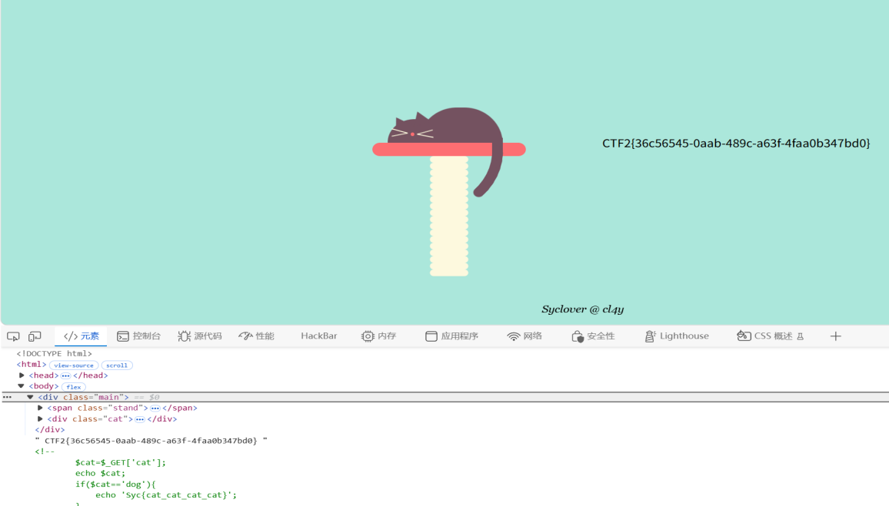

这周主要在练习ctfweb的题目，所以没有很多的内容

这是我第一次自己解出来的题目（没看评论和wp）。这道题是代码审计和前端代码泄露这种，挺有成就感的吧，靠自己完成，虽然是一小步，但是这样是暗示我以后成功的一大步，哈哈（好中二吐槽一下自己，顺便凑字数）

这周还弄了靶机（win 10）和office的激活

这是经过一个中转站代理的激活方法，其实github上面有MAS的激活方式，win10的激活则是一个大佬在评论区分享的密钥，这种东西的流出有很多方面，比如bp的专业版所用的注册机，逆向出来；win10是企业批量泄露等等等等方法

这周yuki大佬分享了服务器和梯子（自搭建）的流程，准备找个时间试一试，这样更让我更深入了解了web方向的知识
