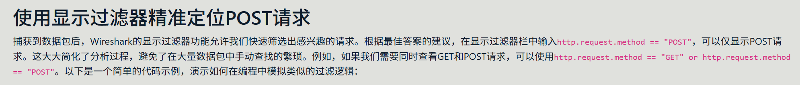

50 4B 03 04这在16进制中为zip压缩包的“代号”，常常在misc隐写中出现，图片里藏有压缩包，经典考题，010可以很快查看出

对于zip有一类很简单的题目伪加密，就是实际上没有加密但在解压时需要密码，这时如果想省事直接随波逐流，也可以在010中自己修改，将0800或0900改成0000（在开头后面一点）即可。010可以解决好多种，图片里隐藏zip等等，我感觉最难的是图片lsb隐写，还没找到一个好用的工具使用，很难受。

这次还学习使用了wireshark的使用，过滤器需要怎么填写等等，对于流量分析确实感觉wireshark会比bp更好用，更清晰吧哈哈

这周主要就是开始刷刷misc的题，马上就要开始比赛了，也不懂会是怎么样的，和上次工业互联网会一样吗？期待一下

对于近半月学习，等这次比完赛，准备开始看小迪安全了解渗透红蓝攻防这类的知识了
